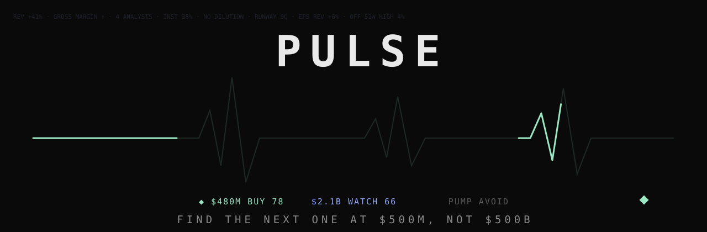

<p align="center">
  
</p>

<p align="center">
  
  
  
  
</p>

<p align="center"><b>Pulse hunts small and niche companies that are quietly dominating, before everyone knows the name.</b><br>
Not "MU has crazy revenue." The point is finding the next one while it's $500M, not $500B.</p>

---

## How it hunts

```
hunt      Yahoo screen: every US-listed stock over $50M with quarterly revenue +25%,
          pre-ranked on trend, extension, size and improving EPS → top 70 researched
          (50 under $10B, 20 proven names above)
heat      names hot in news (Massive, Yahoo), Reddit/X cashtags (scraper.py), small-cap gainers
          → top 50 researched, at most 8 of them megacaps (> $500B) so hype can't crowd out the gems
gate      hard rejects: OTC, < $1, < $1M/day traded, < $10M revenue, shares +30%/yr, reverse split
          (18m), < 4 quarters of cash, pump pattern (+80%/5d on 5x volume with thin fundamentals),
          SEC delisting notice / late filing
score     6 pillars on fixed 0–100 scales → composite − 7 per red flag → BUY / WATCH / AVOID
read      news + social tone (VADER), IWM/SPY/QQQ/VIX backdrop, sector heat, written summary
```

| Pillar | Weight | What it rewards |
|---|---|---|
| Growth | 25% | revenue growth, latest-quarter YoY, acceleration, gross-margin expansion, forward estimates |
| Quality | 18% | margins and their trend, FCF, cash runway, no dilution, low leverage |
| Estimates | 12% | net EPS revisions, estimate drift, surprises, beat rate, target upside |
| Valuation | 8% | EV/sales per point of growth, forward P/E, PEG |
| Momentum | 17% | 3m/6m vs SPY, 1m, off 52w high, above 50/200d |
| Early | 20% | smaller cap, few analysts, institutions near 40% (not crowded), not extended, 1y not parabolic |

BUY needs 70 (75 over $50B, 80 over $500B — the names everyone already knows have to earn it).
No size ceiling: megacaps can be ranked, but the Early pillar scores anything over $500B as zero on size.
The dashboard splits everything into cap bands: **Small** (under $50B, the hunt), **Growth & proven** ($50B–$500B)
and **Megacaps** ($500B+). Megacaps stay hidden unless they're doing something extraordinary (a BUY: 80+ with no
red flags); the Megacaps band shows them all if you want to look.
**◆ Diamonds in the rough**: under $3B, ≤ 6 analysts, growth pillar ≥ 65, quality ≥ 50, score ≥ 60, no red flags.

Red flags (−7 each, 2+ = AVOID): dilution > 15%, recent offering/shelf (SEC), short float > 25%, +50% in 5d,
press-release-heavy news, social hype with no independent coverage, estimate cuts, broken chart, D/E > 3.

News and social volume decide what gets looked at and feed the pump checks. They never add to the score.

## Inside every pick

- **Chart** — line chart in the style of Apple Stocks, 1D / 1W / 1M / 3M / 1Y / 3Y / 5Y / 10Y. Hover to scrub;
  click to pin a date and see the move from there to any point (or to now).
- **Competitors** — the 3 closest US-listed peers by size in the same sub-industry (Finnhub peers), scored with the
  same Pulse model, with a verdict on which is strongest and why.
- **Watchlist** — hit ☆ Watch on any stock to file it into a folder. Each one remembers the day, price and rating
  it was added at, so the watchlist shows what only it can: % since added and rating then → now (with the change),
  next to price and the day's move. One line per stock, folders collapse, click a row to open it.

## What's in the repo

| File | What it does |
|---|---|
| `ranker.py` | discover → gate → research → score → `rankings.json` |
| `server.py` | dashboard on :8790, re-ranks every 60 min |
| `watchlist.py` | watchlist folders and since-added stats → `watchlist.json` (gitignored) |
| `dashboard.html` | the UI: aero-shards hero with paper-airplane picks, sector filter, Apple-style price chart (1D–10Y, click to pin a date and measure from it), competitor check, watchlist |
| `scraper.py` | Reddit (rdt-cli) + X (headless Chrome) → `raw_data.json`, ~13s |
| `save_x_session.py` | log in to X once; saves `x_session.json` (gitignored) |
| `valid_tickers.txt` | listed US tickers used to validate cashtags |

Setup: `pip install -r requirements.txt`, install the `rdt` CLI (rdt-cli) for Reddit and have Google Chrome
installed for X. Run `python save_x_session.py` once to log in to X.

## Run it

```bash
python ranker.py      # one pass → rankings.json (re-runs scraper.py if its data is > 50 min old)
python server.py      # dashboard at http://127.0.0.1:8790, re-ranks every 60 min
```

Always on: `com.rytty.pulse.plist` → `~/Library/LaunchAgents/`, then `launchctl load` it. Logs: `~/Library/Logs/pulse.log`.

Keys in `.env` (gitignored): `MASSIVE_API_KEY`, `FINNHUB_API_KEY`. Optional `SEC_USER_AGENT="name email"`
turns on SEC EDGAR checks (offerings, delisting notices, late filings, insider filings); set it with
`launchctl setenv` so it never lands in a file. Tunables: `PULSE_MIN_MCAP`, `PULSE_MAX_MCAP`,
`PULSE_MIN_DOLLAR_VOL`, `PULSE_MIN_REVENUE`, `PULSE_HUNT_DEEP`, `PULSE_HEAT_DEEP`, `PULSE_INTERVAL_MIN`, `PULSE_SCRAPE=0`.

---

<p align="center">
  Built by <a href="https://x.com/slime2riches">@slime2riches</a> · <a href="https://slimecode.tech">slimecode.tech</a><br>
  <sub>A rules-based screen, not a backtested edge and not investment advice.</sub>
</p>
